<div align="center">


# AMTV — Apple Music для Android TV и Google TV

**Неофициальное приложение Apple Music для Android TV, Google TV, Xiaomi Mi Box, Chromecast with Google TV, NVIDIA Shield и других ТВ-приставок на Android — сделано под пульт.**

[](https://github.com/megarohas/apple-music-android-tv/releases/latest/download/amtv.apk)
&nbsp;
[](LICENSE)

[English version](README.md) · [Установка за 5 минут](#установка) · [Управление пультом](#управление-пультом) · [Вопросы и ответы](#вопросы-и-ответы) · [Как это устроено](#как-это-устроено)

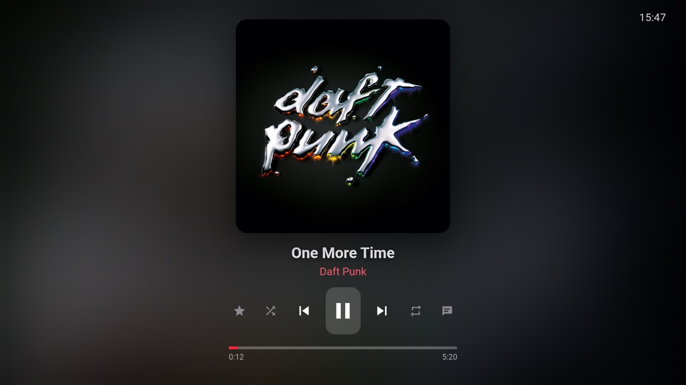

</div>

---

## Что это такое

**Официального приложения Apple Music для Android TV и Google TV нет.** Телефонное приложение Apple можно поставить на приставку вручную, но оно сделано под палец, и пультом им пользоваться мучительно. Можно транслировать музыку с телефона, но тогда пультом становится телефон.

**AMTV** — нормальное приложение Apple Music для телевизора:

- входишь в Apple ID **один раз**, на собственной странице входа Apple;
- ходишь стрелками пульта по разделам **Главная, Обзор, Радио, Медиатека и Поиск**;
- нажимаешь OK, и музыка играет, а на экране спокойный полноэкранный плеер.

Бесплатно, с открытым кодом и **без взломов**: внутри работает **официальный веб-плеер Apple** ([music.apple.com](https://music.apple.com)), а AMTV только надстраивает над ним интерфейс для пульта. Воспроизведение, защита и твой аккаунт остаются у Apple.

> Нужна **подписка Apple Music**. AMTV не связан с Apple и не одобрен ею.

## Скриншоты

| | |
|:---:|:---:|
| 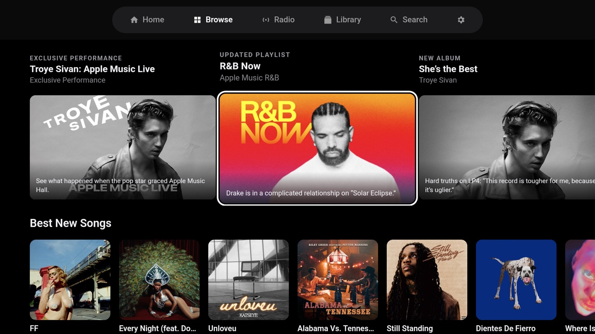 | 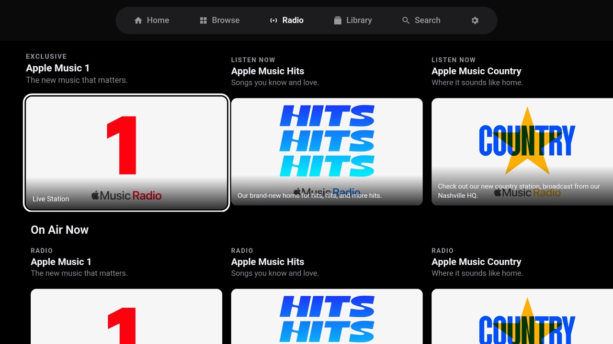 |
| **Обзор** — подборки редакции, новинки, чарты | **Радио** — Apple Music 1, Hits, Country и шоу |
| 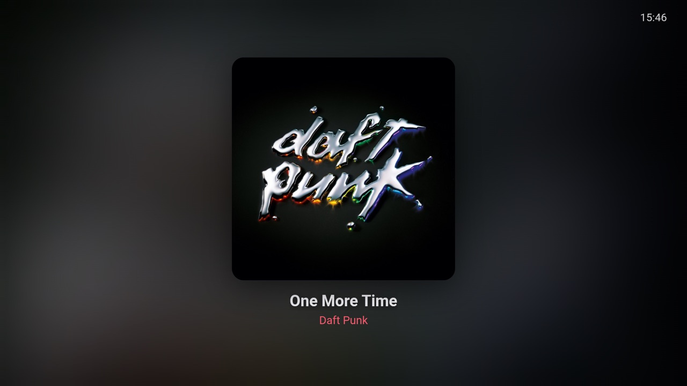 | 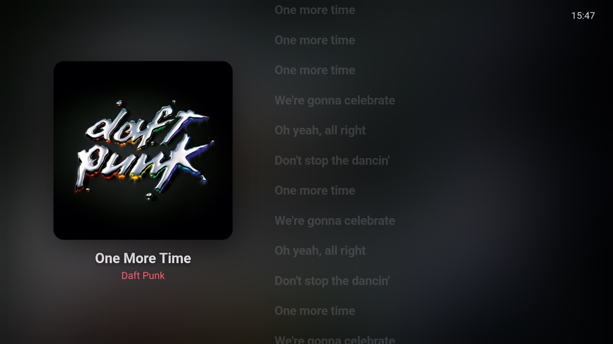 |
| **Сейчас играет** — спокойный вид, кнопки по любому нажатию | **Текст песни** — подсветка по словам, по умолчанию выключен |
| 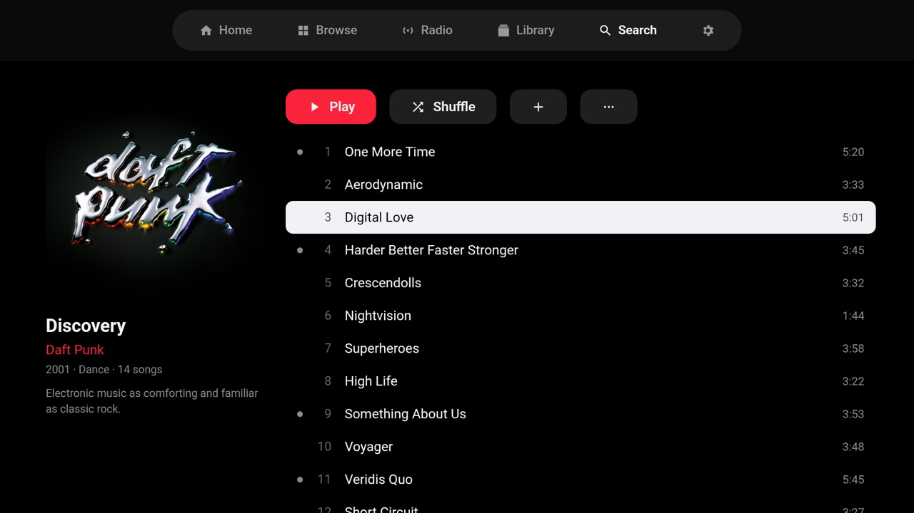 | 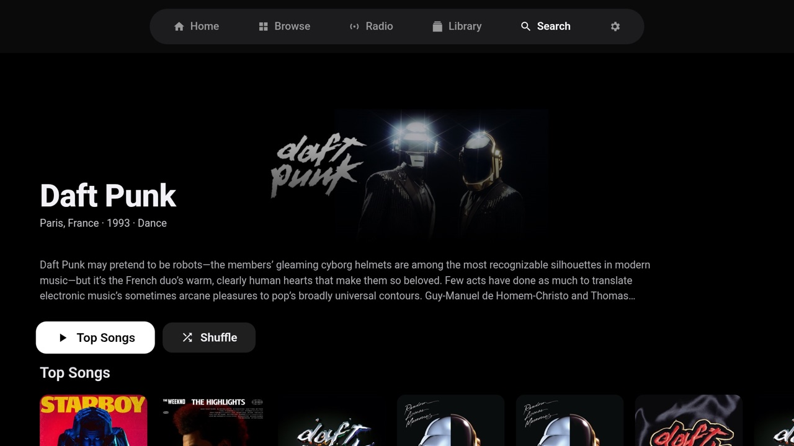 |
| **Альбом** — популярные треки отмечены, «Слушать» / «Перемешать» | **Артист** — биография, популярное, альбомы, похожие |
| 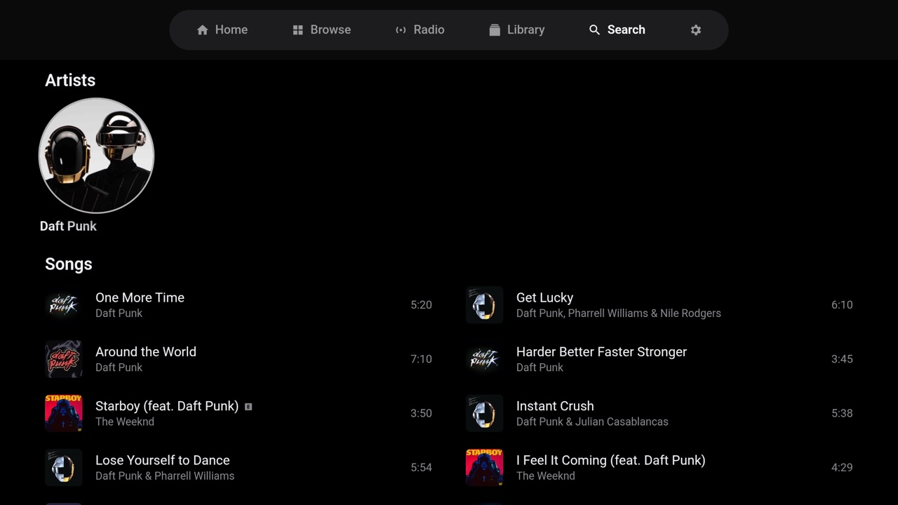 | 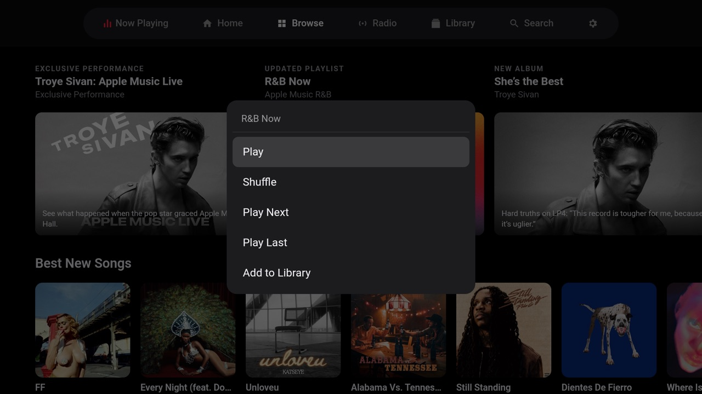 |
| **Поиск** — с экранной клавиатурой телевизора | **Удержание OK** — следующим, в конец очереди, в медиатеку, станция |
| 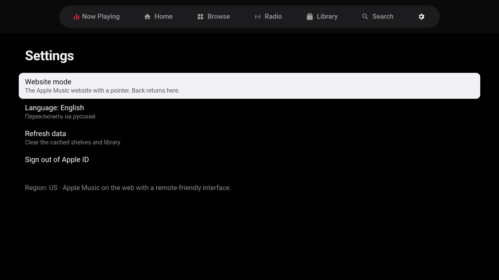 | 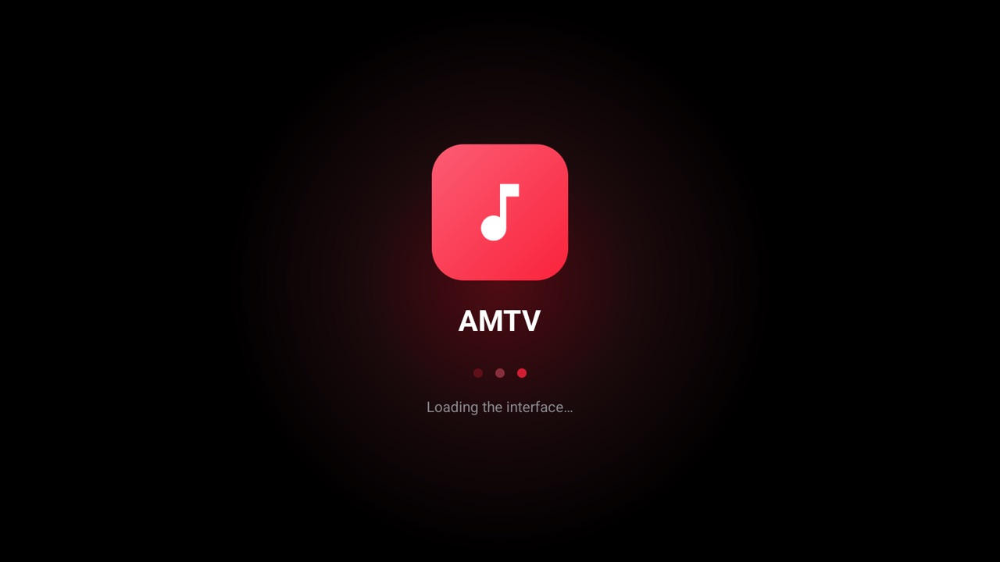 |
| **Настройки** — язык, режим сайта, выход из аккаунта | **Экран запуска** — пишет, что сейчас делает |

*На скриншотах интерфейс на английском; на русской системе он русский.*

## Возможности

- 🎛️ **Под пульт** — стрелки двигают по карточкам, OK включает или открывает, «Назад» возвращает. В каждом ряду запоминается, где ты был.
- 🏠 **Главная** — твои рекомендации: плейлисты «Made for You», недавно прослушанное, станции для тебя, новинки.
- 🧭 **Обзор и Радио** — подборки редакции Apple, чарты, прямой эфир (Apple Music 1, Hits, Country…) и радиошоу.
- 📚 **Медиатека** — недавно добавленные, плейлисты, альбомы, артисты, песни.
- 🔍 **Поиск** — артисты, песни, альбомы, плейлисты и станции, с историей запросов.
- 💿 **Страницы альбомов, плейлистов и артистов** — «Слушать», «Перемешать», «В медиатеку»; популярные треки отмечены, как в Apple Music.
- 🎵 **Сейчас играет** — крупная обложка, плавная смена треков, фон в цветах обложки. Кнопки прячутся сами, **←/→ без кнопок переключают треки**, перемотка с плавным ползунком.
- ⭐ **Избранное** — звезда в плеере (то же, что ⭐ в Apple Music).
- 📝 **Тексты песен** — синхронно по словам, из Apple Music (включаются кнопкой текста в плеере).
- 🗣️ **Голос и автоматизация** — включить станцию или переключить трек можно извне (см. [Автоматизация](#голосовые-ассистенты-и-автоматизация)); работает с открытым голосовым пультом [megarohas_tv_voice](https://github.com/megarohas/megarohas_tv_voice).
- 🌐 **Русский и английский** интерфейс — по языку телевизора, можно переключить в настройках.
- 🐢 **Быстро на слабых приставках** — отлажено на Xiaomi TV Box S (4×Cortex-A55, Mali-G31, 2 ГБ): в простое процессор почти не занят, нет бесконечных анимаций, в фоне ничего не качается.
- 🖱️ **Режим сайта** — полный сайт Apple Music с указателем на экране, для того, чего пока нет в ТВ-интерфейсе.

## Установка

### Что понадобится

- Устройство на **Android TV / Google TV** с **Android 10 или новее** (приставка, стик или телевизор).
- **Подписка Apple Music** и твой **Apple ID**.
- 5 минут.

### Способ 1 — через бесплатное приложение «Downloader» (проще всего, компьютер не нужен)

1. На телевизоре открой **Google Play** и установи **Downloader** (автор AFTVnews).
2. Разреши ему устанавливать приложения: **Настройки → Приложения → Безопасность и ограничения → Неизвестные источники → Downloader → Вкл.**
   *(на разных телевизорах путь немного отличается — поищи в настройках «Неизвестные источники»)*.
3. Открой **Downloader**, введи адрес и нажми **Go**:
   ```
   https://github.com/megarohas/apple-music-android-tv/releases/latest/download/amtv.apk
   ```
4. Когда загрузка закончится, нажми **Установить**, потом **Открыть**.

### Способ 2 — отправить файл с телефона или компьютера

1. Скачай [`amtv.apk`](https://github.com/megarohas/apple-music-android-tv/releases/latest/download/amtv.apk).
2. Отправь его на телевизор приложением вроде **Send Files to TV**, **LocalSend** или на флешке.
3. Открой файл на телевизоре файловым менеджером и нажми **Установить** (когда спросит, разреши файловому менеджеру «Неизвестные источники»).

### Способ 3 — через ADB (для тех, кто любит покопаться)

```bash
adb connect <IP-телевизора>:5555
adb install amtv.apk
```

### Первый запуск

1. Открой **AMTV** в ряду приложений (красная плитка с нотой).
2. Нажми **Войти** — откроется страница входа Apple, приспособленная под пульт: **↑ / ↓** выбирают поле или кнопку (красная рамка), **OK** на поле открывает экранную клавиатуру, **OK** на кнопке нажимает её. Вводишь Apple ID → «Продолжить» → пароль → «Войти». Код двухфакторной проверки придёт на iPhone / Mac, как обычно.
   > Совет: приложение **Google TV** на телефоне работает как клавиатура для телевизора — туда можно вставить пароль из менеджера паролей.
3. Готово — AMTV переключится в ТВ-интерфейс. Вход сохраняется: в следующий раз сразу откроется главная.

> Пароль вводится **только на странице Apple** (`idmsa.apple.com`). AMTV его не видит и не хранит.

## Управление пультом

| Кнопка | Что делает |
|---|---|
| **← ↑ → ↓** | Перемещение по карточкам, рядам и верхней панели. Вкладка открывается, как только на неё попадаешь. |
| **→ в конце ряда / ← в начале** | Следующая / предыдущая вкладка (с главной **←** ведёт прямо в «Сейчас играет»). |
| **OK** | Включить песню или станцию, открыть альбом / плейлист / артиста. |
| **Удержание OK** | Меню: «Слушать», «Перемешать», «Сыграть следующим», «В конец очереди», «В медиатеку», «Станция по песне». |
| **Назад** | На предыдущую страницу → на главную → выход из приложения (музыка встаёт на паузу). |
| **Play/Pause, следующий, предыдущий** (если есть на пульте) | Управление музыкой из любого места приложения. |

В плеере («Сейчас играет»):

| Кнопка | Что делает |
|---|---|
| любая | Показывает кнопки (через несколько секунд они прячутся) |
| **← / →**, когда кнопки скрыты | Предыдущий / следующий трек |
| **↓** на полосу прогресса, потом **← / →** | Перемотка по 10 секунд (одна плавная перемотка, когда отпустишь) |
| ⭐ | В избранное / убрать из избранного |
| кнопка текста | Текст песни вкл. / выкл. |

## Голосовые ассистенты и автоматизация

AMTV понимает простые команды-интенты Android, поэтому им могут управлять голосовые пульты, программы автоматизации или скрипты:

```bash
# включить станцию / плейлист / альбом (откроет приложение, если нужно, и покажет плеер, когда пойдёт звук)
adb shell am start -n com.megarohas.amtv/.MainActivity --es play ra.978194965      # Apple Music 1
adb shell am start -n com.megarohas.amtv/.MainActivity --es play pl.<id-плейлиста>

# управление плеером
adb shell am start -n com.megarohas.amtv/.MainActivity --es cmd next        # next | prev | pause | play | toggle
adb shell am start -n com.megarohas.amtv/.MainActivity --es cmd favorite    # ⭐ добавить текущую песню
adb shell am start -n com.megarohas.amtv/.MainActivity --es cmd unfavorite  # убрать её (ничего не делает, если её там нет)
```

ID — те же, что в ссылках Apple Music (`music.apple.com/…/playlist/…/pl.xxxx`, станции `ra.…`, альбомы — числа). Голосовой пульт [megarohas_tv_voice](https://github.com/megarohas/megarohas_tv_voice) работает именно так: «Пульт, включи музыку» будит приставку, открывает AMTV и включает твою станцию.

## Вопросы и ответы

<details><summary><b>Есть ли официальное приложение Apple Music для Android TV / Google TV?</b></summary>

Нет (на 2026 год). У Apple есть Apple Music для Android-телефонов и для некоторых смарт-ТВ (Samsung, LG), но не для приставок на Android TV / Google TV. AMTV закрывает этот пробел с помощью веб-плеера самой Apple.
</details>

<details><summary><b>Это законно? Взламывается ли защита?</b></summary>

AMTV **не обходит** защиту DRM и не вытаскивает токены. Музыка играет через официальный веб-плеер Apple со встроенным в телевизор Widevine — точно так же, как в браузере на компьютере на music.apple.com. Нужна своя оплаченная подписка. AMTV — независимый неофициальный проект.
</details>

<details><summary><b>Заработает ли на моей приставке / Fire TV?</b></summary>

Проверено на **Xiaomi TV Box S (2-го поколения), Google TV, Android 14**. Должно работать на любом устройстве с Android TV / Google TV, Android 10+ и Widevine (а это практически все сертифицированные: Chromecast with Google TV, NVIDIA Shield, Mi Box, телевизоры с Google TV). На Fire TV не проверялось — будем рады отчётам.
</details>

<details><summary><b>Lossless, Dolby Atmos, клипы?</b></summary>

AMTV играет то же, что веб-плеер Apple: качественный AAC. Lossless и Dolby Atmos в вебе недоступны. Музыкальные клипы пока не поддерживаются.
</details>

<details><summary><b>Почему первый запуск занимает около 10 секунд?</b></summary>

Приложение загружает веб-плеер Apple и восстанавливает вход — на экране запуска видно, что именно происходит. Станция стартует за несколько секунд: плеер Apple получает её треки, лицензию на воспроизведение и начало звука. Дальше всё кэшируется и открывается быстро.
</details>

<details><summary><b>Играет ли музыка, если выйти из приложения?</b></summary>

При выходе (кнопка «Домой», другое приложение) музыка встаёт на паузу, а под заставкой телевизора — продолжает играть.
</details>

<details><summary><b>Подборки из другой страны</b></summary>

Apple Music показывает каталог страны твоего Apple ID. До входа сайт может угадать страну по IP-адресу.
</details>

## Если что-то не так

| Проблема | Что попробовать |
|---|---|
| Завис экран запуска | Проверь интернет; через 30 секунд экран запуска сдаётся и показывает сайт. |
| Каждый раз просит войти | Проверь дату и время на телевизоре; войди заново через «Настройки → Режим сайта». |
| Нет звука или «Не получилось включить» | Нужен Widevine (есть на всех телевизорах с сертификацией Google). Проверь, что подписка активна на music.apple.com. |
| Вместо ТВ-интерфейса появился указатель | Нажми **Назад** — из режима сайта он вернёт в ТВ-интерфейс. |
| После обновления что-то выглядит странно | «Настройки → Обновить данные» или очисти данные приложения в настройках Android (придётся войти заново). |

## Как это устроено

```
┌──────────────── AMTV (приложение Android) ──────────┐
│  WebView ── music.apple.com (веб-плеер Apple)        │
│    │          ├── MusicKit JS: твоя сессия Apple ID   │
│    │          └── <audio> + Widevine: воспроизведение │
│    └── ТВ-интерфейс (HTML/CSS/JS в shadow DOM)        │
│           данные  ← API MusicKit (amp-api)            │
│           звук    → MusicKit setQueue / play          │
│  Кнопки пульта ─► MainActivity ─► ТВ-интерфейс        │
│  Интенты (--es play / --es cmd) ─► плеер              │
└──────────────────────────────────────────────────────┘
```

- **Без трюков с DRM и токенами.** Интерфейс запрашивает API Apple через сессию MusicKit самой страницы и запускает музыку через MusicKit — как это делает сайт.
- **Страница Apple остаётся загруженной, но скрытой** (`content-visibility: hidden`) — плеер принадлежит ей. AMTV держит её на странице без анимированных обложек и отклоняет запросы, которые она делала бы только для себя (видеообложки, свои превью, аналитика): на слабой приставке это разница между запуском станции за 20 и за 4 секунды.
- **Под слабую графику** — никаких blur-фильтров и бесконечных анимаций; фон плеера — холст 64×36, размытый и нарисованный один раз на трек, растянутый на экран; текст песни сдвигается по таймерам к следующему слову, а не каждый кадр; полоса прогресса — один CSS-переход.
- **Навигация пультом** — небольшой движок фокуса: ряды элементов, память позиции в ряду, полки едут через `transform`, переход на вкладку с края ряда и указатель мыши для режима сайта.

Карта кода:

| Путь | Что внутри |
|---|---|
| `src/com/megarohas/amtv/MainActivity.java` | WebView, экран запуска, маршрутизация кнопок пульта, интенты, фильтр запросов |
| `src/com/megarohas/amtv/Cursor.java` | указатель на экране для режима сайта |
| `res/raw/page.js` | небольшие правки, которые вставляются в страницу Apple |
| `res/raw/tv_core.js` | ТВ-интерфейс: движок фокуса, вкладки, API, воспроизведение, переводы |
| `res/raw/tv_screens.js` | Главная, Обзор, Радио, Медиатека, Поиск, Настройки, альбом / плейлист / артист |
| `res/raw/tv_player.js` | «Сейчас играет»: фон, тексты, перемотка, избранное |
| `res/raw/signin.js` | страница входа Apple под пульт: рамка выбора, стрелки, OK открывает клавиатуру (только оформление, введённое не читает) |
| `res/raw/brand.js` | настройки оформления (иконки, шрифт) — единственный файл, который меняет своя сборка |
| `tools/cdp.mjs` | помощник для Chrome DevTools: смотреть и перезаливать интерфейс на живом телевизоре |

## Сборка из исходников

Без Gradle — Makefile вызывает инструменты Android SDK напрямую, сборка занимает несколько секунд.

Нужно: **Android SDK** (build-tools 36.0.0, платформа `android-36`), **JDK 17**, `make`, `adb`.

```bash
git clone https://github.com/megarohas/apple-music-android-tv.git
cd apple-music-android-tv
make                                   # → build/amtv.apk (подписан твоим debug-ключом)
make install TV=192.168.1.50:5555      # приставка, подключённая по adb; или впиши `TV = …` в local.mk
make start

make dev-install && make dev-start    # отдельное приложение «AMTV Dev» рядом (свой вход и данные) — для тестов
```

Пути можно переопределить: `make SDK=/путь/к/sdk BT=$SDK/build-tools/36.0.0`.

Разработка на живом телевизоре без переустановки:

```bash
make devtools                                  # пробрасывает DevTools WebView на localhost:9222
node tools/cdp.mjs run res/raw/tv_core.js res/raw/tv_screens.js res/raw/tv_player.js
node tools/cdp.mjs eval '__tv.boot()'          # интерфейс перезалит
node tools/cdp.mjs shot screen.png             # или смотри в chrome://inspect
```

Своё оформление (иконки и шрифт) кладётся в `res/raw/brand.js` и `assets/fonts/` — подробности в комментариях этого файла.

## Благодарности

- [**JObersi10/apple-music-tv**](https://github.com/JObersi10/apple-music-tv) — нативный клиент Apple Music для Android TV; его исследования веб-API Apple (эндпоинты главной, обзора, радио, текстов, избранного) и идеи ТВ-интерфейса очень помогли. Код не копировался. Тот проект сам расшифровывает потоки; AMTV сознательно этого не делает и оставляет воспроизведение плееру Apple.
- [**Material Icons**](https://github.com/google/material-design-icons) (Apache License 2.0) — основа набора иконок AMTV. См. [NOTICE](NOTICE).
- **Apple MusicKit on the Web** — плеер и API Apple, с которыми работает AMTV.

## Правовое

AMTV — независимый проект с открытым кодом, **не связанный с Apple Inc., не уполномоченный и не одобренный ею.** Apple, Apple Music и Apple ID — товарные знаки Apple Inc. и упоминаются только чтобы описать, с чем работает приложение. AMTV не содержит шрифтов, иконок и логотипов Apple, не изменяет и не обходит DRM и требует действующей подписки Apple Music. Обложки на скриншотах принадлежат их правообладателям и показаны для иллюстрации.

## Лицензия

[MIT](LICENSE) © 2026 megarohas
